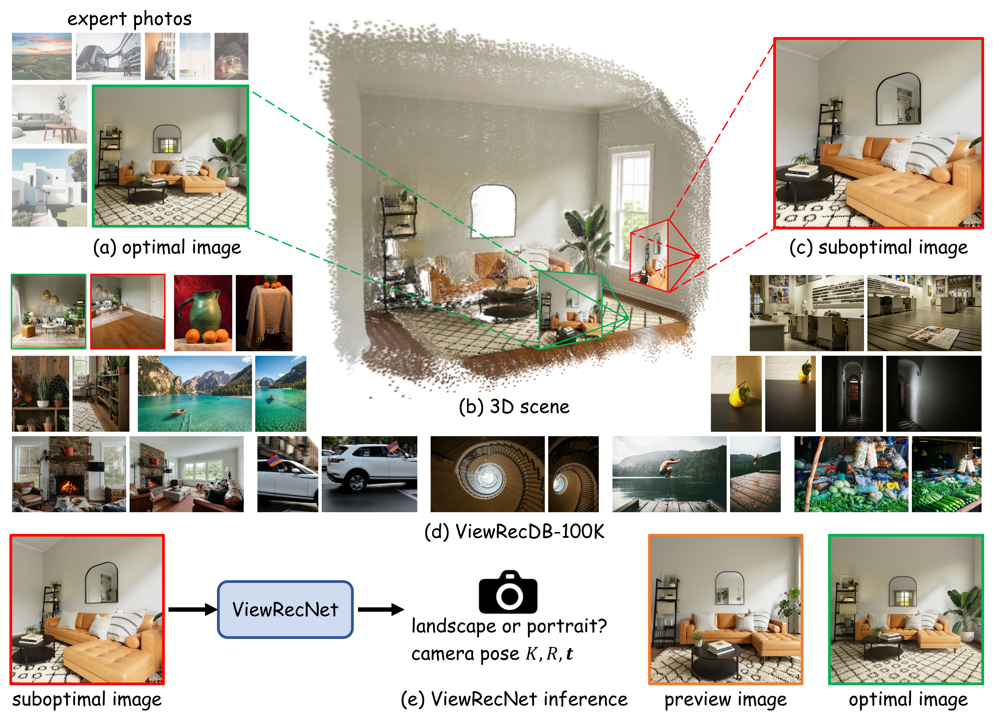

<div align="center">
<h1 align="center">ViewRec3D: Learning to Recommend 3D Viewpoints for AI Photography</h1>

<p align="center">
<a href="https://czzhang2026.github.io/ViewRec3D/ViewRec3D.pdf"></a>  <a href="https://czzhang2026.github.io/ViewRec3D/"></a> <a href="https://huggingface.co/datasets/czZhang2026/ViewRecDB-100K"></a> <a href="https://huggingface.co/czZhang2026/ViewRecNet"></a>
</p>

<p align="center">
<strong><sup>1</sup>Beijing Institute of Technology</strong> &nbsp;&nbsp; <strong><sup>2</sup>University of California, Merced</strong>
</p>

<p align="center">
Chengzhi Zhang<sup>1,*</sup>, Yunzhong Hou<sup>1,*,†</sup>, Zizheng Sun<sup>1</sup>, Ming-Hsuan Yang<sup>2</sup>, Chi Harold Liu<sup>1</sup>
</p>

<p align="center"><sup>*</sup>Equal contribution. &nbsp;&nbsp; <sup>†</sup>Corresponding author.</p>
</div>

<p align="center">
  
</p>
## 🔎 Overview

ViewRec3D introduces a novel data generation pipeline for the 3D viewpoint recommendation task and releases a 100K-scale high-quality dataset built with this pipeline. Trained on this dataset, our model achieves strong quantitative and qualitative performance, supported by LLM-based viewpoint preference evaluation and human studies.

## ✨ Highlights

* 📦 Dataset and benchmark: large-scale 3D viewpoint recommendation dataset `ViewRecDB-100K` and task-specific benchmark `ViewRecEval`.
* 🛠️ Data generation: automated pipeline for constructing suboptimal-to-optimal viewpoint pairs with `3D reconstruction`, `rendering`, `restoration`, and `hierarchical filtering`.
* 🧠 Model and supervision: view recommendation model `ViewRecNet` with a `ray-based dense supervision`.

## 🚀 Quick Start

**🧩 Preparation**

Clone this repository to your local machine, and install the dependencies:

```bash
git clone git@github.com:anonymous1-submission/ViewRec3D.git
cd ViewRec3D
conda create -n ViewRec3D python=3.12
conda activate ViewRec3D
pip install -r requirements.txt
```

Manually download the `VGGT` checkpoint file from [here](https://huggingface.co/facebook/VGGT-1B/resolve/main/model.pt?download=true), rename the downloaded `model.pt` file to `vggt.pt`, and place it under `src/vggt/VGGT-1B/`.

**🏋️ Training**

Download our dataset `ViewRecDB-100K` from [here](https://huggingface.co/datasets/czZhang2026/ViewRecDB-100K) and decompress it.

We train our model on `2 × NVIDIA RTX 5090 GPUs` using the following command:

```bash
python -m torch.distributed.run \
  --master_port=29500 \
  --nproc_per_node=2 \
  -m src.train \
  --train_dir your_dir/train \
  --val_dir your_dir/test \
  --output_dir your_dir/output \
  --use_rays True \
  --num_train_epochs 5
```

To further validate the results of our ablation studies and variant experiments, you can modify the `data_ratio`, `data_angle`, and `use_rays` parameters. More details can be found in `src/vggt/arguments.py`.

## 🙏 Acknowledgement

This work was supported by the National Natural Science Foundation of China (No. U25A20434)

## Citation

Final BibTeX will be provided once the author list and public publication identifier are available.
